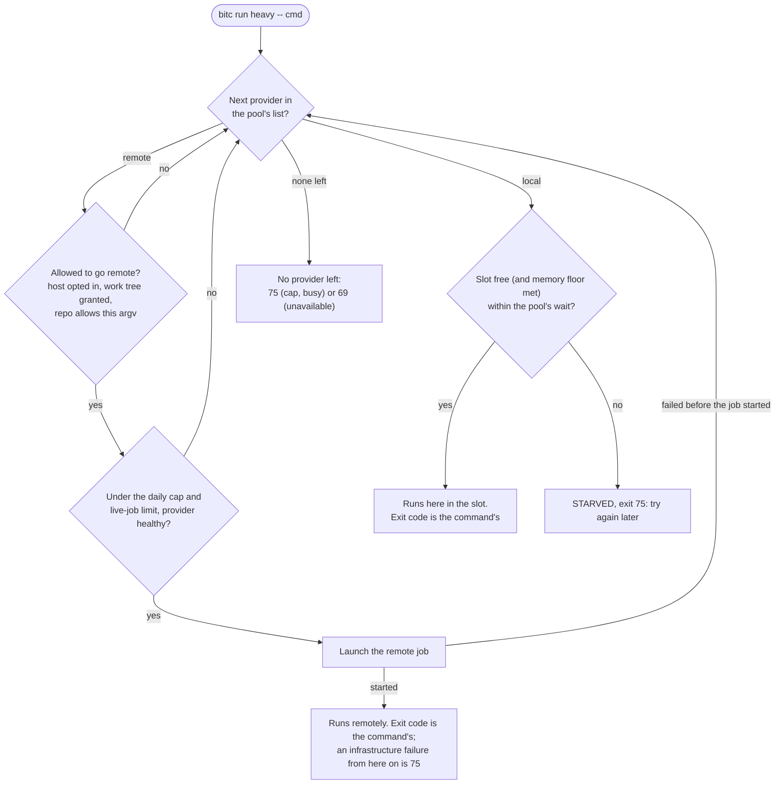
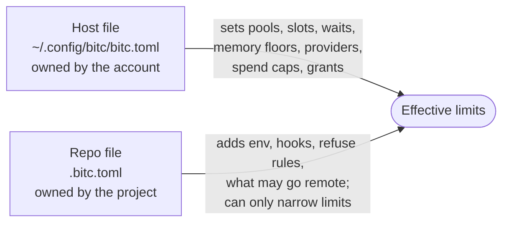

<picture>
  <source media="(prefers-color-scheme: dark)" srcset="docs/assets/bitc-dark.svg">
  
</picture>

Run heavy commands on a shared machine without letting them knock it over. bitc queues them in
named pools of slots on your machine, and can offload them to a remote provider (a RunPod pod, a
machine you own over SSH, or a plugin of your own) under a daily spend cap. When a command cannot
start in time, bitc exits **75**, "try again later", and never pretends your command failed.

[](https://github.com/Exploded-views/bitc/actions/workflows/ci.yml)
[](https://pkg.go.dev/github.com/Exploded-views/bitc)
[](https://goreportcard.com/report/github.com/Exploded-views/bitc)
[](https://github.com/Exploded-views/bitc/releases)
[](LICENSE)
[](go.mod)

```console
$ bitc run heavy -- npm test               # waits for a free slot, then runs; exit code is npm's
$ bitc run --wait 1s heavy -- npm test     # from another terminal, while the first still runs
STARVED heavy
$ echo $?
75
```

bitc is a single static binary, built for machines shared by AI coding agents. It works the same
for a person at a terminal.

## Why it exists

Ten coding agents on one 16 GiB machine will each start a type checker, a browser suite and a
database at the same moment, and the machine falls over. A lock alone does not fix that: the agents
also need to know whether to wait, retry or give up, and remote compute needs a spending limit.

- **Slots and a queue.** A pool with N slots runs N commands at a time, in FIFO order, with
  priority lanes, groups shared across pools and, for a pool that declares its `memory`, a memory
  floor that holds a job back instead of letting the kernel kill something (Linux only).
- **Exit codes callers can act on.** 75 means wait and retry and 69 means stop and report; bitc's
  few other codes are in the [table below](#exit-codes), and anything else is your command's own.
  Agents follow a [ten-rule guide](docs/agent-guide.md).
- **No daemon.** State is files and `flock(2)` locks. A caller that is killed releases everything
  it held, and the next caller cleans up after it.
- **Spend-capped offload (experimental).** A daily cap per priced provider account, a live-job
  limit, a ledger and a circuit breaker bound what remote jobs can cost. A job that has not started remotely
  falls back to the next provider in the pool's list, often `local`.
- **A trust split.** The host file sets capacities, spend caps and providers. A repository's
  `.bitc.toml` can only narrow those limits, never widen them.

The local gate is the mature part. Every remote provider is experimental and off by default; read
[Known issues](#known-issues) before pointing one at a real account.

## Install

Linux (amd64 or arm64) is the main platform. The macOS builds run local pools only
([macOS status](docs/install.md#macos-status)).

Download a release binary and check it against `checksums.txt`
([docs/install.md](docs/install.md) has the commands and lists every asset), or build it with Go
1.26 or newer:

```sh
go install github.com/Exploded-views/bitc/cmd/bitc@v0.1.0
```

## Quickstart (local, about two minutes)

No account or network needed. The test suite runs every block below as written; the outputs come
from a real run, so paths, ids and memory figures will differ on your machine.

**1. Describe your machine.** One pool, `heavy`, with one slot:

<!-- doc-test -->
```sh
mkdir -p ~/.config/bitc
cat > ~/.config/bitc/bitc.toml <<'EOF'
version = 1

[pools.heavy]
slots = 1
EOF
chmod 600 ~/.config/bitc/bitc.toml   # bitc refuses a group- or world-writable config
bitc config check
```

```text
ok host /home/you/.config/bitc/bitc.toml repo (none)
```

**2. Run a command through the pool.** bitc waits for a free slot, runs the command and returns
the command's own exit code. stdout is the command's; bitc writes only to stderr.

<!-- doc-test -->
```sh
bitc run heavy -- echo hello
bitc status
```

```text
hello
heavy: 0/1 slots held, 0 waiting
memory: 15350 MiB available (MemAvailable), floor 6144 MiB
```

**3. See "try again later".** While one command holds the only slot, a second caller waits up to
the pool's `wait` (10 minutes by default; `--wait` shortens it here), then gives up with
`STARVED heavy` and exit 75:

<!-- doc-test -->
```sh
bitc run heavy -- sleep 3 &     # takes the only slot
sleep 1
bitc run --wait 1s heavy -- echo second || echo "exit $?"
bitc status
wait
```

```text
STARVED heavy
exit 75
heavy: 1/1 slots held, 0 waiting
  slot 1  19e3b439  pid 10745  since 2026-10-27T18:15:22Z  sleep 3
  last STARVED: all slots busy at 2026-10-27T18:15:24.777Z
memory: 15354 MiB available (MemAvailable), floor 6144 MiB
```

**4. Outlast a tool-call limit.** A detached job returns at once; `bitc wait` blocks for up to 9
minutes per call by default (`--timeout`) and exits 124 while the job is still running, so an
agent just calls it again:

<!-- doc-test -->
```sh
bitc run --detach --name demo heavy -- sh -c 'echo hi'
bitc wait demo
```

```text
started demo pid 14890 log /home/you/.local/state/bitc/jobs/22bb2cbb/demo/out.log
RESULT exit 0
--- last 60 lines of /home/you/.local/state/bitc/jobs/22bb2cbb/demo/out.log ---
hi
__EXIT__ 0
```

The other commands are `logs`, `cancel`, `sweep`, `doctor` and `version`; `bitc` alone prints
the usage line. Next, add a repository file ([configuration](docs/configuration.md)) or point your
agents at [the agent guide](docs/agent-guide.md).

## Offload to a provider (experimental)

> [!WARNING]
> Remote providers are experimental and off by default, and their spend accounting is still
> being hardened. The `experimental_remote` switch below is new in the next release; v0.1.0
> rejects it as an unknown key. See [Known issues](#known-issues).

A pool can list providers in order of preference. The host file says which providers a pool may
use, how much it may spend and which work trees may go remote:

```toml
# ~/.config/bitc/bitc.toml
version = 1

[host]
experimental_remote = true             # remote providers are off by default

[pools.heavy]
slots = 1
providers = ["runpod", "local"]        # preference order; local is the fallback
remote_limits = { size = { runpod = "cpu8" } }

[remote_limits]
worktrees = ["**/worktrees/agent-*"]   # only these work trees may go remote

[providers.runpod]
api_key_file = "~/.config/bitc/runpod.key"
daily_usd = 25                         # the spend cap for this provider account
image = "docker.io/library/debian:bookworm-slim"
sizes = { cpu8 = { cpu_type = "cpu3c", vcpu = 8, usd_per_hour = 0.24 } }
# The pod downloads the bitc agent from a URL you host. The default source, "release", needs a
# release build of bitc; this example uses a URL instead.
agent = { source = "url", url = "https://example.com/bitc_linux_{arch}", path = "/opt/bitc/bitc" }
```

The repository says what may leave the machine:

```toml
# .bitc.toml at the top of the work tree
version = 1

[pools.heavy.remote]
allow = [["npm", "run", "coverage", "--"]]   # only these argv prefixes may go remote
artifacts = [{ path = "coverage" }]          # copied back after the job
```

```console
$ bitc run heavy -- npm run coverage --
bitc: runpod: heavy job heavy-3f2a91 on x7k2p0q9 (cpu8) at 9c1e5b0d4a77
...
$ bitc run heavy -- npm run coverage --        # later, near the cap: runs locally instead
bitc: runpod: running heavy locally: daily cap $25.00: spent $24.80 + committed $0.00 + this job $0.40
...
```

The output is shortened and the ids are examples; the shape of both `bitc:` lines is real
([docs/exit-codes.md](docs/exit-codes.md)). Both files pass `bitc config check` on Linux. A real
repository usually also needs a `[remote]` profile for setup steps ([examples/](examples/) has
complete files). Run `bitc sweep` from a timer ([docs/sweep-timer.md](docs/sweep-timer.md)) so a
job that dies at the wrong moment does not leave a paid resource behind.
[docs/providers.md](docs/providers.md) covers each provider and its state.

## How it works

`bitc run <pool> -- <command>` walks the pool's `providers` list in order (a pool with no list is
just `local`). Simplified:



Once a remote job has started it never falls back, so a half-started job never runs its load
twice. Every rule is in [docs/spec.md](docs/spec.md) section 8.2.

Two files configure bitc, and they are trusted differently:



Details are in [docs/configuration.md](docs/configuration.md) and
[docs/concepts.md](docs/concepts.md).

## Exit codes

| Code | Meaning | What to do |
| --- | --- | --- |
| the command's own | the command ran; `128+N` if signal N killed it | treat it as the real result |
| 64 | usage: bad arguments, unknown pool, refused by a rule or hook | fix the call |
| 66 | no such detached job | check the job name |
| 69 | unavailable: not Linux or macOS, a Linux-only feature on macOS, unusable hook, no usable provider, internal error | stop and report; do not retry blindly |
| **75** | temporary failure: starved, or a remote infrastructure failure after the job started | wait, then run again |
| 78 | invalid configuration | fix the configuration |
| 124 | `bitc wait` only: the job is still running | call `wait` again |

A command that itself exits 75 shows up as `RESULT exit 75` in `bitc wait`: read the first line,
not only the code. The stderr lines are in [docs/exit-codes.md](docs/exit-codes.md); the rules
for agents are in [docs/agent-guide.md](docs/agent-guide.md).

## Documentation

| Read | For |
| --- | --- |
| [docs/agent-guide.md](docs/agent-guide.md) | the rules an AI agent follows when it runs commands through bitc |
| [docs/concepts.md](docs/concepts.md) | pools, slots, groups, tickets, nested holds, providers, state |
| [docs/configuration.md](docs/configuration.md), [docs/config-reference.md](docs/config-reference.md) | the two config files, and every key with its class and default |
| [docs/exit-codes.md](docs/exit-codes.md) | exit codes, stderr lines, `wait` outcomes, `result.json` |
| [docs/providers.md](docs/providers.md) | remote providers, their state, and running them safely |
| [docs/install.md](docs/install.md) | release assets, building from source, macOS status |
| [docs/comparison.md](docs/comparison.md), [docs/faq.md](docs/faq.md) | bitc next to `flock`, GNU `parallel` and CI concurrency; common questions |
| [docs/threat-model.md](docs/threat-model.md), [docs/spec.md](docs/spec.md) | what bitc defends against; the full design |

## Status and roadmap

bitc is pre-1.0 ([v0.1.0 release notes](https://github.com/Exploded-views/bitc/releases/tag/v0.1.0)),
so interfaces may still change.

- **Stable in intent:** the local gate (pools, slots, groups, priority lanes, memory admission,
  nested holds, detached jobs, `status`, `sweep`, `doctor`), the exit codes and the config schema.
- **Experimental:** every remote provider. `runpod` was proven live on CPU pods before v0.1.0; a
  live re-proof of the release path is pending. `ssh` and exec plugins are implemented, and the
  [plugin protocol](docs/plugin-protocol.md) may still change.
- **macOS:** local pools only ([macOS status](docs/install.md#macos-status)).
- **Next release:** see [CHANGELOG.md](CHANGELOG.md#unreleased).

Open issues that make up the roadmap:

- [#3](https://github.com/Exploded-views/bitc/issues/3), [#4](https://github.com/Exploded-views/bitc/issues/4),
  [#5](https://github.com/Exploded-views/bitc/issues/5): macOS parity, macOS as a client to remote
  providers (planned for 0.1.2), macOS as a remote build target (design first)
- [#6](https://github.com/Exploded-views/bitc/issues/6): Sprites catch-all egress deny
- [#7](https://github.com/Exploded-views/bitc/issues/7), [#8](https://github.com/Exploded-views/bitc/issues/8):
  RunPod ordered data-centre walk with a per-pool US-only option; fallback CPU types per size
- [#9](https://github.com/Exploded-views/bitc/issues/9): the launch lock must exclude across
  implementations during a mixed rollout (spend-cap safety)
- [#10](https://github.com/Exploded-views/bitc/issues/10): IO-pressure admission (`io_pressure_max`)

Later: signed checksums after 1.0, packages under the name `bitc`, and volume caches for remote
jobs ([spec.md](docs/spec.md) section 16.1, not scheduled).

## Known issues

- Remote providers are experimental and off by default (`experimental_remote`): their spend
  accounting is still being hardened. In 0.1.0 specifically: same-named concurrent jobs in one
  pool can collide, and some interrupted-create paths can leave a resource unpriced until its
  expiry. Local pools are not affected.

  A host with unfinished remote jobs left by an earlier version and no flag gets one more line from
  every refused command: set the flag and run `bitc sweep` to clean up what is left. If you
  deleted a provider's table instead, `bitc doctor` and `bitc sweep` still point out its
  unfinished jobs.
- The v0.1.0 release predates the `experimental_remote` switch: it rejects the key as unknown
  (exit 78) and runs configured remote providers without it, Sprites included. Configure remote
  providers on 0.1.0 only with the cautions above in mind.
- Sprites jobs are refused in this release (exit 78, even with `experimental_remote`): its
  network policy does not restrict egress yet, and a job would receive the forwarded environment
  and the deploy key. Fix tracked in [#6](https://github.com/Exploded-views/bitc/issues/6). To
  clean up Sprites left by 0.1.0, keep the `[providers.sprites]` table, set
  `experimental_remote = true` under `[host]` and run `bitc sweep` (the sweep timer keeps
  working): it only lists Sprites, checks their owner tag and deletes this install's.
- In 0.1.0 the shipped example `examples/config/repo.bitc.toml` declares `min_version = "1.0.0"`,
  so a 0.1.0 build refuses it (exit 78); set it to `"0.1.0"`. Fixed in 0.1.1.

## Sibling projects

- [crewkit](https://github.com/Exploded-views/crewkit): tools and practices for running a crew of
  Claude Code sessions against one repository and one host.
- [claude-utils](https://github.com/Exploded-views/claude-utils): a fork of
  [MarimerLLC/claude-utils](https://github.com/MarimerLLC/claude-utils), cross-workstation tooling
  for Claude Code (memory sync).
- [yo-human](https://github.com/Exploded-views/yo-human): the channel between a crew of AI agents and
  their human. The repository is private for now (design stage), so the link may not open yet.

## Contributing

Bug reports and feature requests go to
[GitHub issues](https://github.com/Exploded-views/bitc/issues/new/choose) (use the issue
templates). Pull requests are welcome; [CONTRIBUTING.md](CONTRIBUTING.md) covers building,
`make ci` and the conformance register. Please follow the [Code of Conduct](CODE_OF_CONDUCT.md),
and report security problems privately as [SECURITY.md](SECURITY.md) describes, never in a public
issue.

## License

MIT. See [LICENSE](LICENSE).
